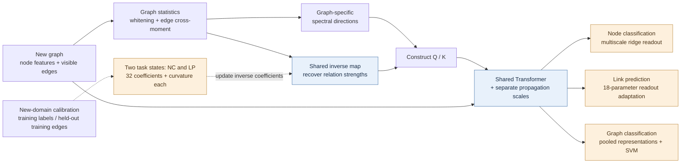

# EvoGFM

**Recover graph-specific attention from observations; accumulate experience in a shared inverse map.**



The model estimates relation directions from each graph and uses one learned inverse family to recover their strengths. It constructs attention in a forward pass. Source training learns the shared model; target adaptation freezes its weights. Continual calibration keeps two small states keyed by **task type**, shared across graph domains.

The [paper draft](1106-EvoGFM_paper.md) is included unchanged. This release contains the current empirical implementation, including task-conditioned calibration and the LP residual readout. The draft's convex relation-calibration analysis does not provide a regret guarantee for the nonlinear task-logit GGN optimizer used by `continual.py`.

The latest [V6 experiments](EXPERIMENTS_V6.md) retain the same frozen source model and add RBF features, training-error correction and balanced graph pooling. Evaluation covers 11 node-classification graphs, public and hard-negative link prediction, joint five-shot/sparse-edge adaptation, PROTEINS/NCI1 graph classification, and a four-domain continual stream. [V6 measured results](results_v6.json), [V5](results_v5.json) and [V4](results.json) are stored separately.

[Five complete published comparison tables](BEST_TABLES.md) preserve all original baseline rows and dataset columns, adding our best observed V4–V6 results. The [provenance index](best_results.json) identifies each result's version and measurement file. This cross-version development summary is separate from the latest V6 results.

## Install

Python 3.10+ and PyTorch 2.6. The current commands run on CPU with four threads; a GPU is not required.

```bash
git clone https://github.com/HayesShi/EvoGFM.git
cd EvoGFM
python -m pip install -r requirements.txt
```

## Run

Run these commands from the repository root, in the same terminal environment where Python is installed. Downloads and experiments show progress bars.

```bash
# Download source / target graphs and prepare public evaluation splits.
python prepare.py

# Train on Pubmed, Photo and Texas; select the checkpoint on source validation.
python train.py --epochs 60

# Public node classification and link prediction: validation first.
python evaluate.py

# Evaluate the selected configuration on public tests.
python evaluate.py --split test

# Mechanism ablation: zero inverse amplitudes / biases and refit the LP readout.
python evaluate.py --ablation zero-inverse

# Stream Cora -> Citeseer; measure Roman-empire as the future domain.
python continual.py
```

The expanded experiments add four heterophily graphs and official HeaRT hard negatives:

```bash
python prepare.py --datasets amazon-ratings minesweeper tolokers questions
python evaluate.py --nc cora citeseer roman-empire amazon-ratings minesweeper tolokers questions --lp --node-readout adaptive --nc-metric auto --output runs/expanded
python evaluate.py --nc cora citeseer roman-empire amazon-ratings minesweeper tolokers questions --lp --node-readout adaptive --nc-metric auto --split test --output runs/expanded
python continual.py --stream cora citeseer amazon-ratings --future minesweeper tolokers --nc-metric auto --output runs/expanded_continual
```

For HeaRT, place the official Citeseer files from the [benchmark archive](https://github.com/Juanhui28/HeaRT) under `data/heart/citeseer/`: `train_pos.txt`, `valid_pos.txt`, `test_pos.txt`, `heart_valid_samples.npy`, `heart_test_samples.npy`, and `gnn_feature`. Then run `python heart.py` followed by `python heart.py --split test`. The evaluator preserves official candidate ordering and averages tied ranks. [EXPERIMENTS.md](EXPERIMENTS.md) documents the setup, results and ablations.

A short execution check uses `python train.py --sources texas --epochs 1 --output runs/check`. Each entry point accepts `--help`, `--data-root`, `--output` and `--threads` where applicable. Evaluation and continual calibration accept `--checkpoint`.

## What each experiment measures

| Goal | Procedure | Report |
| :--- | :--- | :--- |
| Fast adaptation | Freeze the source model; fit an NC ridge head or an LP residual readout | Accuracy / Hits@100 / AUC |
| Knowledge retention | Adapt along the domain stream and re-evaluate earlier domains | Final average, forgetting, backward transfer |
| Knowledge accumulation | Evaluate future domains at every stream prefix without adapting on them | Future score curve and gain |

**Source training.** Default sources are Pubmed, Photo and Texas, seed 42. The objective combines source link BCE, hard-negative ranking and episodic node classification. Training performs four updates per epoch for 60 epochs. All learned weights are selected using source validation.

**Public adaptation.** NC uses the official training labels with a ridge penalty selected on validation. LP retains the frozen source head and fits 17 residual weights plus an intercept with eight Newton steps. Four masked views use training edges only; a fixed set of calibration pairs stays disjoint from readout fitting across all views. The residual penalty is selected on this calibration holdout.

`--node-readout adaptive` selects among four fixed readouts: the original features, a smaller Transformer contribution, separate zero-to-four-hop features, or those features plus a 512-dimensional quadratic sketch. `enhanced` adds a 2048-dimensional sketch and training-label diffusion. `advanced` also considers 256-landmark RBF features and correction propagated from training-node residuals. Each new component requires more than 0.1 percentage point of validation improvement. Selection uses validation labels. `--nc-metric auto` uses ROC-AUC for binary graphs and accuracy otherwise. The original readout remains the default.

For V6, use the same checkpoint throughout; the commands below assume the one generated by `train.py`:

```bash
python prepare.py --datasets actor ogbn-arxiv computers wikics
python evaluate.py --nc cora citeseer roman-empire amazon-ratings minesweeper tolokers questions actor ogbn-arxiv computers wikics --lp --node-readout advanced --nc-metric auto --output runs/v6

# Five training labels per class and 20% observed edges together.
python evaluate.py --nc cora citeseer roman-empire amazon-ratings --lp --node-readout advanced --shots 5 --edge-rate 0.2 --output runs/v6_joint

# Official HeaRT candidate files must already be installed as above.
python heart.py --negative-mode mixed --output runs/v6_heart

# Whole-graph classification, nested 10-fold SVM evaluation.
python classify_graphs.py --balanced-readout --output runs/v6_proteins
python classify_graphs.py --dataset NCI1 --balanced-readout --output runs/v6_nci1

# Extend the domain stream; report all controls and future-domain trajectories.
python continual.py --stream cora citeseer actor amazon-ratings --future minesweeper tolokers --task both --nc-metric auto --output runs/v6_continual
```

For NC/LP, inspect validation results before adding `--split test`. Five-shot means five training nodes per class **plus official validation labels for selection**. The joint setting also keeps 20% of graph edges. Mixed link calibration uses training-graph hard nonedges; official HeaRT candidates are unchanged. PROTEINS/NCI1 use one-hot node labels without continuous node attributes. Balanced pooling fits scaling inside each training fold and selects the encoder-block weight in inner CV. Local official raw caches are reused when available.

**Continual calibration.** Each task updates 32 inverse coefficients; eight bias coefficients remain frozen. Its 40 × 40 curvature metric starts with source task information and accumulates final-logit GGN estimates. The runner compares `static`, `cumulative` and `reset` controls. NC uses official training labels; LP uses a separate native masked-edge split. Future-domain labels are used only for reporting. The same two task states serve every graph; no per-domain adapter is stored.

Continual reports use validation scores. LP continual AUC is a separate experiment from the public NCN Hits@100 protocol. A future score gain is empirical evidence, and can be negative; the runner reports the full trajectory.

## Data and public references

Raw numerical features are row-normalized when nonnegative, then mapped into one graph-wide SVD100 frame. The original features remain available to the task readouts. Data downloads and generated splits are cached under `data/`.

| Task | Targets | Protocol / published reference |
| :--- | :--- | :--- |
| Node classification | Cora, Roman-empire | Planetoid masks / Roman mask column 0, following the saved seed-42 [GraphAny](https://github.com/DeepGraphLearning/GraphAny) convention (ICLR 2025) |
| Expanded node classification | Citeseer, Amazon-ratings, Minesweeper, Tolokers, Questions | Planetoid masks / official heterophily mask column 0; binary graphs use ROC-AUC |
| Link prediction | Cora, Citeseer | [NCN](https://github.com/GraphPKU/NeuralCommonNeighbor/blob/main/ogbdataset.py) 70/10/20 split and Hits@100 (ICLR 2024) |
| Hard link prediction | Citeseer | [HeaRT](https://github.com/Juanhui28/HeaRT) official positives and 500 hard negatives per positive (NeurIPS 2023) |
| Larger node classification | ogbn-arxiv | Official OGB time split (NeurIPS 2020); 169,343 nodes |
| Additional heterophily | Actor | Official Geom-GCN split 0 (ICLR 2020); GraphAny published reference |
| Additional node classification | Computers, WikiCS | GraphAny's stratified 200-total-label Computers split / official WikiCS split 0 |
| Graph classification | PROTEINS, NCI1 | TU graphs; nested 10-fold SVM, inspired by GraphCL evaluation (NeurIPS 2020) |

Public data come from [Planetoid](https://github.com/kimiyoung/planetoid), [GNN Benchmark](https://github.com/shchur/gnn-benchmark), [Geom-GCN](https://github.com/graphdml-uiuc-jlu/geom-gcn) and [Heterophilous Graphs](https://github.com/yandex-research/heterophilous-graphs). The LP splitter preserves PyG's Planetoid edge order before randomization so that the seed-42 splits match the existing experiments.

Recorded V6 development results from the same source checkpoint selected at epoch 21. NC rows use the advanced readout; the public LP and retained HeaRT configurations are unchanged:

| Public task | EvoGFM, seed 42 | Published reference |
| :--- | ---: | ---: |
| Cora NC, accuracy (%) | 79.60 | GraphAny-Wisconsin: 77.82 ± 1.15 |
| Citeseer NC, accuracy (%) | 69.70 | GraphAny-Wisconsin: 67.50 ± 0.44 |
| Roman-empire NC, accuracy (%) | 74.37 | GraphAny-Wisconsin: 64.06 ± 0.78 |
| Amazon-ratings NC, accuracy (%) | 47.20 | GraphAny-Wisconsin: 42.57 ± 0.34 |
| Actor NC, accuracy (%) | 32.96 | GraphAny-Wisconsin: 29.51 ± 0.55 |
| ogbn-arxiv NC, accuracy (%) | 67.88 | GraphAny-Wisconsin: 57.79 ± 0.56 |
| Computers NC, accuracy (%) | 84.73 | GraphAny-Wisconsin: 82.00 ± 1.14 |
| WikiCS NC, accuracy (%) | 79.75 | GraphAny-Wisconsin: 73.77 ± 0.83 |
| Cora LP, Hits@100 (%) | 86.35 | NCNC: 89.65 ± 1.36 |
| Citeseer LP, Hits@100 (%) | 92.64 | NCNC: 93.47 ± 0.95 |
| Citeseer HeaRT LP, MRR (%) | 31.17 | NCN: 28.65 ± 1.21 |

The references are reported by the papers; external baselines were not retrained. Training sources and budgets differ, and these public tests were observed during development. These numbers are development comparisons. Checkpoints are generated locally by `train.py` and are not included in this repository.

The [complete comparison tables](BEST_TABLES.md) cover GraphAny, NCN, HeaRT and GraphCL, including every original model and dataset. The [V6 report](EXPERIMENTS_V6.md) records gains and unchanged results, the rejected link trial, and all continual controls. Balanced pooling raises PROTEINS from 75.65% to 77.18%, still below the statistics-only control's 77.26%; NCI1 reaches 78.39% versus that control's 72.00%. Their ± values are outer-fold variation, while GraphCL reports a different averaging protocol. The [V5](EXPERIMENTS_V5.md) and [V4](EXPERIMENTS.md) reports preserve earlier declines and inverse ablations. Stable future-domain knowledge accumulation remains unproven.

## Files and outputs

```text
prepare.py                  Download data and create evaluation splits
train.py                    Source training
evaluate.py                 Public NC / LP evaluation and inverse ablation
heart.py                    Official HeaRT hard-negative evaluation
classify_graphs.py          Frozen graph representations and nested SVM evaluation
continual.py                Task-conditioned stream experiments
evogfm/model.py             Inverse map and programmed attention
evogfm/features.py          Graph frame, propagation and pair features
evogfm/data.py              Graph loaders and split protocols
evogfm/readout.py           Ridge and offset-logistic readouts
evogfm/online.py            Online Newton update and task-state bank
evogfm/training.py          Source objective and checkpoint loading
evogfm/evaluation.py        Masked-view LP adaptation and public evaluation
evogfm/continual.py         Curvature calibration and stream measurements
tests/                      Numerical and protocol regression tests
EXPERIMENTS.md              Expanded experiments and mechanism findings
EXPERIMENTS_V5.md           Larger datasets, harder tasks and V5 comparisons
EXPERIMENTS_V6.md           Eleven graphs, joint scarcity and graph pooling
BEST_TABLES.md              Five complete published tables with our best results
best_results.json           Cross-version best-result provenance
results.json                Measured development results
results_v5.json             V5 measured results and PROTEINS folds
results_v6.json             V6 measured results, folds and continual matrices
1106-EvoGFM_paper.md         Original supplied manuscript draft
```

Default outputs are `runs/source/best.pt`, `runs/public/val_none.json` and `runs/continual/{nc,lp}_validation.json`. Continual snapshots and the final `task_bank.pt` include coefficient vectors and curvature metrics. Data, weights and run outputs stay local.

To load an existing checkpoint:

```python
from evogfm.training import load_checkpoint

model, link_head, metadata = load_checkpoint("runs/source/best.pt")
```

## Development checks

```bash
python -m pip install -e ".[dev]"
python -m pytest -q
python -m ruff check .
python -m black --check .
```
