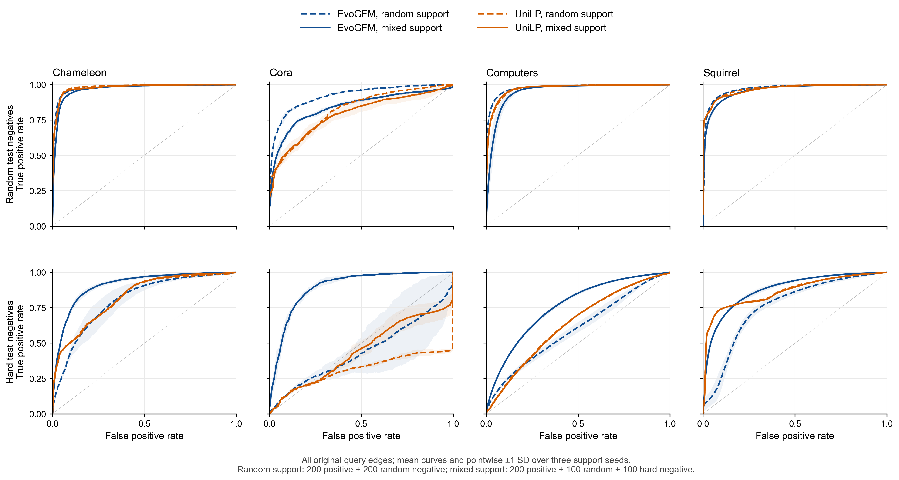
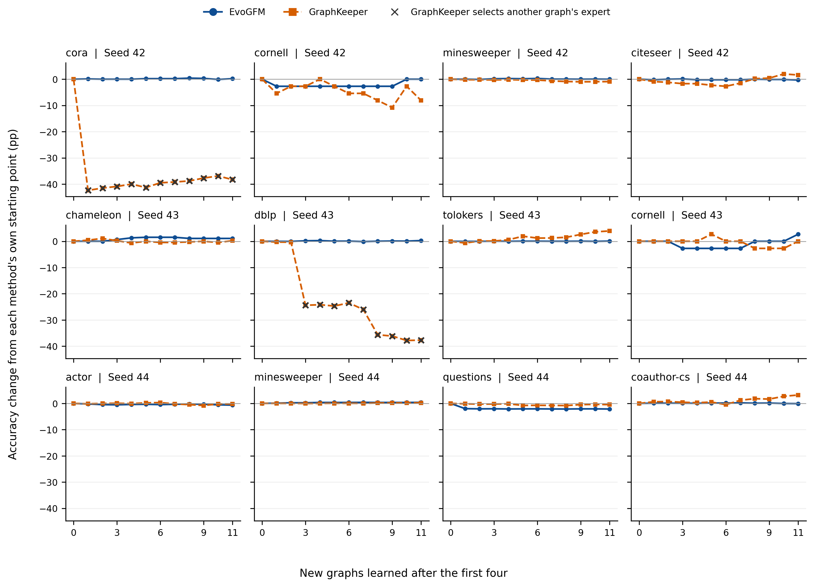

# Figure inputs

| Input | Contents | Renderer |
|---|---|---|
| `data/link_curves.npz` | ROC/PR curves for four graphs, two test-negative settings, two models, two support settings and seeds 42–44 | `scripts/plot_link_prediction.py` |
| `data/retention.csv`, `data/retention_orders.json` | Complete first-four-graph historical trajectories, prefixes 4–15, for EvoGFM and GraphKeeper | `scripts/plot_retention.py` |
| `data/nc_graphany.csv`, `data/nc_graphglue.csv` | Per-graph few-shot comparison summaries | `scripts/plot_node_classification.py` |

These are measured inputs from the November 12–13 baseline round. The compact
LP archive stores each seed's curves on the original 501-point grid, not raw
predictions. Its axes are `(kind, graph, test negatives, model/support, seed, x)`;
the archive includes the labels for every axis. Shading shows pointwise sample
SD over support seeds. Exact AUC/AP should be computed from raw predictions,
not from interpolated display curves.

In the LP figures, dashed lines use random support (200 positive + 200 random
negative edges). Solid lines use mixed support (200 positive + 100 random + 100
hard negative edges). The two panel rows separately show random and hard *test*
negatives.

The retention plot shows changes from each method's own prefix-4 accuracy.
Crosses mark GraphKeeper choosing another graph's expert. These curves describe
within-method retention, not absolute cross-method accuracy.

PNG previews are included below. Regenerate PDF/SVG with the commands in the
[reproduction guide](../docs/reproduction.md#plotting).

