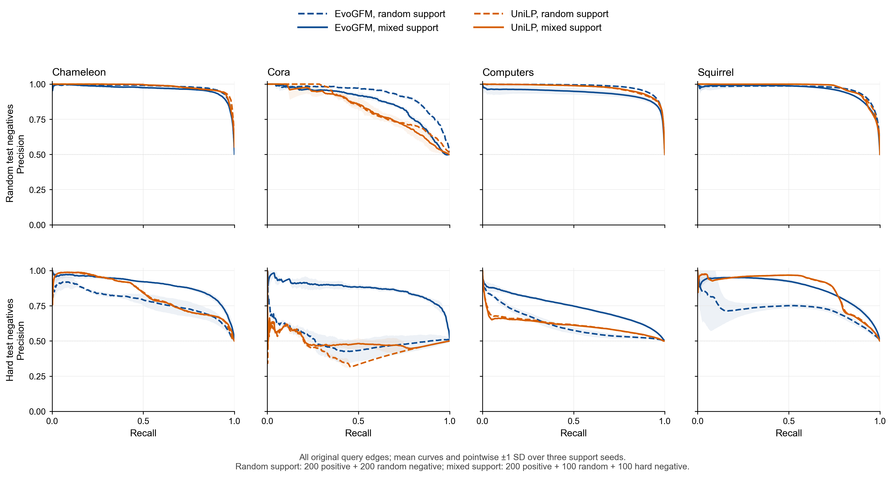

# Figure previews

The repository retains the images below. Measured plotting inputs and result
tables are kept locally. Plotting scripts and input formats are documented in
the [reproduction guide](../docs/reproduction.md#plotting).

In the LP figures, dashed lines use random support (200 positive + 200 random
negative edges). Solid lines use mixed support (200 positive + 100 random + 100
hard negative edges). The two panel rows separately show random and hard *test*
negatives.

The retention plot shows changes from each method's own prefix-4 accuracy.
Crosses mark GraphKeeper choosing another graph's expert. These curves describe
within-method retention, not absolute cross-method accuracy.

